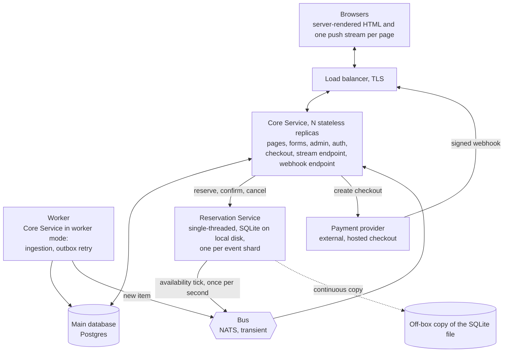
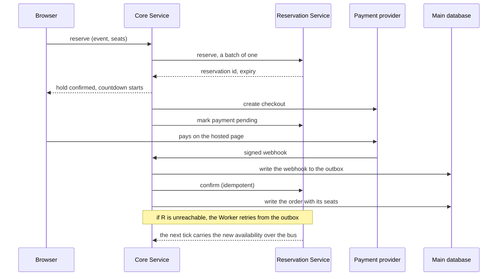

# ADR-001: OneSport system architecture

| | |
|---|---|
| Status | Proposed |
| Date | 2026-10-28 |
| Scope | Whole system: content, ticketing, social, accounts |
| Supersedes | none |

## 1. Context

OneSport is a sports news site that also sells tickets to sporting events. Users can save content and connect with other users. The requirements are a short system description and 24 user stories, all written from the end-user perspective.

Reading the stories against the description produced seven requirements that shape the architecture. The rest of the stories (login, logout placement, profile settings, list views) are commodity features. This record does not discuss them further.

| # | Driver | Source | Why it matters |
|---|---|---|---|
| D1 | Two content types, news and events. Each item has a source: ingested from an external feed, or written by an editor. | stories 7, 8, 11, 12 and the description | One model must serve both origins. Otherwise every feature exists twice. |
| D2 | An ingestion pipeline with a per-source policy: publish automatically, or wait for editorial review. | inferred. Nobody inside OneSport can write all sports news. | The first workload that is not a request and a response. |
| D3 | An editorial role. The stories do not mention it, but it must exist. | inferred from D1 | Needs admin pages to create, edit, approve, and hide items. |
| D4 | Ticket purchase with two fulfilment modes. Native means inventory, seats, and payment. Redirect means a link to an external vendor. | the description and story 13 | The only part with hard correctness requirements and extreme write contention. |
| D5 | Personal collections of news and tickets, including clear all. | stories 9, 10, 13, 14, 15, 20, 21 | Collections point at items that editors can hide and events that can sell out. |
| D6 | A small social graph: send, accept, refuse, and remove friend requests, and find a user by email. | stories 16 to 19, 22 to 24 | The only user-to-user relational data. Lookup by email lets an attacker enumerate accounts. |
| D7 | Account deletion. | story 5 | Collections, friendships, and requests cascade. Orders stay, anonymised. |

The design rests on these assumptions:

- Purchase is in scope, including payment, even though no story exercises it.
- Content is a hybrid. Feeds supply most news, and editors can add and edit. Most events redirect, and some sell natively.
- Player and match statistics are out of scope for now. Statistics overwrite the latest value, and that is a different write pattern.
- The friend list does only what the stories state. No chat, no feed.
- A native mobile app is plausible later.

The discussion settled on eight design rules:

1. Variation lives in configuration and item state, never in duplicated code. Source policy, fulfilment mode, and item state are fields. The feature matrix must not become code paths.
2. Do not build code that has one caller. Adapters are the only code that multiplies, and they multiply linearly with the number of sources.
3. One writer per event. Ticket contention cannot be distributed within an event, only across events.
4. Every number on a page has one source. If a value is pushed, nothing pulls it on demand. Two sources for one value need reconciliation code, and that code exists only because the data was split.
5. No cache that needs invalidation. A stale value is a snapshot with a stated staleness bound, and the write path checks the real value.
6. The bus holds no state. Producers publish only after their database commit returns.
7. Pushed live updates are a property of the system, not a feature of one page. The push mechanism is built once. Availability uses it now. Statistics and a friend feed add subjects to it later.
8. The website has no JSON API. Pages are server-rendered HTML. A mobile API, when needed, is a separate thin layer over the same service functions.

## 2. Architectures considered

The discussion compared four shapes across the three main subsystems.

| | News and ingestion | Purchasing | Social and collections | Verdict |
|---|---|---|---|---|
| A. Modular monolith. One codebase, one database, modules with enforced boundaries, a worker mode for background work. | Fine. The worker shares the code and the database. | Strongest consistency. But under a hot event, waiting transactions exhaust the connection pool and slow the whole site. | Easiest. Plain tables and foreign keys. | Chosen, with one exception for purchasing. |
| B. Domain services. Content, commerce, and social with identity as separate services, each with its own database, connected by asynchronous messages. | Good. Content becomes a standalone product. | Commerce is isolated, and that is the right idea. But more replicas do not help one hot row. | Awkward. Collections span services and no service owns them. | Rejected for content and social. Its isolation of purchasing is adopted. |
| C. Event log with read models. Every change appends to a stream, and consumers build purpose-shaped views. | Best fit on paper. In practice the read model is the same indexed table that A already has. | Serialises writes per event. But the reserve click becomes asynchronous. A queue defers the spike instead of absorbing it, and impatient users re-click and multiply the load. | Overkill. | Rejected. |
| D. Composed managed services. Hosted auth, a headless CMS, provider-hosted checkout, cloud functions for ingestion, and a thin custom backend. | Good. | The last-seat invariant becomes an integration problem between vendors. | Custom anyway. | Rejected. |

Purchasing decided the choice. The hot-event problem is one counter, one row, and thousands of concurrent decrements. Horizontal scaling adds compute while the bottleneck is data. A queue, as in C, turns contention into a state-tracking problem with thousands of waiting connections. The right shape is a single writer per event that answers synchronously in milliseconds. That is a small single-threaded service, not an architecture.

## 3. Decision

The system is a modular monolith, the Core Service, scaled horizontally over one relational database. One single-threaded Reservation Service per shard of events owns seat allocation. A transient message bus carries push updates.

### 3.1 Components

| Component | Instances | Owns | Does |
|---|---|---|---|
| Core Service | N, stateless | an in-memory availability map only | Serves every page and form. Runs admin, auth, and checkout. Holds the browser push streams. Receives payment webhooks. |
| Worker | 1 | nothing | Runs the Core Service binary in worker mode: scheduled ingestion with one adapter per source, and outbox retry. |
| Main database | 1 primary, a read replica if needed | users, content, sources, collections, social, orders, webhook outbox, statistics | Stores all relational state. |
| Reservation Service | 1 per event shard | holds, seat allocation, and sold counts during the sale window | Validates and records holds through a batch-shaped API. Publishes the full availability state once a second. |
| Bus | 1 | nothing persistent | Fans out availability ticks and new-item notices. Later carries statistics and social events. |
| Payment provider | external | payment | Hosts the checkout page and sends signed webhooks. |

### 3.2 State ownership

| State | Source of truth | Lifetime |
|---|---|---|
| Users, sessions, roles | main database | forever |
| Articles, events, sources and their policies, item state and history | main database | forever |
| Sale window, ticket categories, and seat maps, as editors define them | main database | forever |
| Collections, friendships, friend requests | main database | forever. Deleted with the account. |
| Orders with their seats, payment references, webhook outbox | main database | forever. Anonymised when the account is deleted. |
| Match statistics (future) | main database, append-only per match with a view of the latest row | forever |
| Holds and in-flight seat allocation | Reservation Service, in SQLite | the sale window. An archive afterwards. |
| Current availability per event | derived. The Reservation Service publishes it, the bus carries it, and each replica holds it in memory. | one second |

The bus is never a source of truth. The Reservation Service copies its file off the machine continuously. A failure can lose holds. A failure cannot lose a sale, because every confirm also writes an order to the main database.

### 3.3 Reservation Service model

An event has one or more ticket categories. A category is either a quantity pool or a set of named seats. Both use the same tables. A seat is a category entry with a label. A pool is a category with a capacity and no labels.

A reservation records who, which event, which seats or which category and quantity, when it was created, when it expires, and its state. The states are `held`, `payment_pending`, `sold`, and `cancelled`. Every state change appends a row to a history table.

Expiry is a query condition, not a background job. The pending set is the reservations in state `held` whose creation time is within the expiry window. No periodic job writes anything, so nothing adds latency at the tail.

The invariants are database constraints inside one transaction:

- A seat label appears in at most one active reservation for its event.
- For a pool, held plus sold never exceeds capacity.
- A user has at most one active reservation per event. A repeated click returns the existing reservation.

The API is batch-shaped. It takes a list of reservation requests and returns a list of per-item results. A single click is a batch of one. Under load, a Core Service replica may merge a few milliseconds of requests into one call. The endpoint and the code are the same, so batching is a tuning parameter. Each replica keeps a persistent connection to the service.

The service has no concept of payment. The Core Service talks to the payment provider and reports only the outcome.

| Call | Effect |
|---|---|
| reserve(event, items) | Validates the items, creates the holds, and returns the reservation ids and expiries. |
| mark payment pending(id) | Protects the hold from expiry while the provider processes the payment. |
| confirm(id) | Moves the reservation from held to sold. Idempotent. |
| cancel(id) | Releases the reservation. Idempotent. |
| provision(event, categories, seats) | Registers an event. The Core Service calls it when an editor opens a sale. |

### 3.4 Availability has one path

1. Once a second, the Reservation Service reads its pending set and its sold counts. This is a read, with no write and no fsync. It publishes the full current state of every event in its sale window, one subject per event.
2. Every Core Service replica subscribes to all availability subjects and keeps the latest state per event in memory. Page rendering and browser push both read this map and nothing else. The Core Service never asks the Reservation Service for availability.
3. One publisher per subject and full-state messages make the stream ordered and self-correcting. The next tick corrects a missed message. There is no snapshot request, no version reconciliation, and no retained message on the bus.
4. The tick is also a heartbeat. If a replica hears nothing about an event for a few seconds, it renders "temporarily unavailable" instead of a stale number.
5. Outside the sale window the Reservation Service publishes nothing, and the page renders "opens at" or "closed" from the main database.
6. A reserve response tells the user whether they got the hold and when it expires. It does not update the number on the page. That number arrives through the stream, as it does for every other viewer.

### 3.5 Flows

**Read a page.** The browser requests a page. The Core Service runs one query on the main database and returns HTML. There is no cache layer. If reads ever outgrow the primary, the next step is a read replica.

**Ingest.** The Worker schedule fires a source. The source's adapter fetches the feed and normalises it into the one schema, including country and sport. The shared pipeline deduplicates the items and writes each one in the state the source policy dictates, `published` or `pending_review`. For a published item, the Worker puts a notice on the bus. Editors approve, edit, or hide items through forms on the same rows, whatever the item's origin.

**Open a sale.** An editor sets the window, the categories, and the seats in the main database. The Core Service provisions the event into the Reservation Service. When the window closes, the orders in the main database already hold the final allocation, and the SQLite data becomes an archive.

**Reserve and pay.**

A webhook can arrive after the hold expired. A grace period for reservations in `payment_pending`, and a refund for the rare miss, are business rules on top of these states. The architecture supplies the `payment_pending` state that makes those rules possible.

**Push.** A page opens one stream and names the subjects it wants. Each replica subscribes to those subjects on the bus and forwards HTML fragments to the streams that asked for them. The producers are the Reservation Service for availability, the Worker for items and future statistics, and the Core Service for future social events. Nothing polls.

**Social and collections.** These are forms on relational tables. Find-by-email is rate limited and returns the same response whether or not the email exists. A collection item that an editor hid, or an event that sold out, stays in the list with a flag. Nothing in a user's list disappears without explanation.

**Delete an account.** Foreign keys cascade the deletion to collections, friendships, and requests. Orders stay with the user reference anonymised, because they are financial records.

### 3.6 Frontend

The Core Service renders HTML on the server. A push-first hypermedia library, datastar or similar, handles interaction. A click fetches an HTML fragment. A live value arrives as a fragment over the page's stream. The library's reactive signals hold small client state such as the selected seats and the countdown. The one exception is the article editor, a self-contained browser component inside a normal form, with no API behind it.

The website has no JSON API. When a mobile app needs one, the API is a thin second HTTP layer over the same service functions, written for mobile's needs rather than inherited from the web.

The discussion rejected three alternatives:

- A TypeScript metaframework with the backend folded in. It locks the language, its dependencies move fast, every page pays a component render on the server, and its server functions are not an API, so a mobile app would still need one built.
- A single-page application. Search engines cannot index it without extra work, and a news site depends on indexing.
- Elixir LiveView. It suits a product where every page is live. Here only a few pages are live, so the site would carry two interaction models.

### 3.7 A bus instead of database notifications

Postgres notifications would work at launch volume, and they publish inside the transaction for free. The discussion rejected them for three reasons:

- Every publisher needs a connection to the primary database. The Reservation Service touches only its own disk by design. With database notifications, the payment path would depend on the main database being up.
- The primary serialises notifications at commit time. Future statistics traffic would contend with orders and signups.
- Payloads are small, channels are flat, and only the primary can deliver them.

NATS is one small stateless process. The cost is losing transactional publish. Rule 6 covers that: both producers publish only after their commit returns.

## 4. Consequences

### What the design gains

- Two persistent stores with unambiguous ownership. The bus is transient.
- Purchasing correctness lives in one small program and in database constraints, independent of the language it is written in.
- The hot-sale path is synchronous and answers in milliseconds. There is no queue, no polling, and no waiting-room state.
- Every number on a page has exactly one source, so there is no reconciliation code.
- Push is designed in once. A future live feature adds subjects, not mechanisms.
- One codebase covers everything except the Reservation Service. The Worker is the same binary.

### What the design accepts

- When a Reservation Service instance fails, its events are off sale until it recovers from the off-box copy. Holds may be lost. A hot standby per instance would double the hardware for little gain.
- The main database is a single primary. A read replica is the first scaling step.
- Availability is up to one second stale. If a hot sale shows the need, the Reservation Service can also publish on commit, on the same subject.
- The bus is one more process to run.
- The push-first frontend library is young and changes faster than the rest of the stack. The design depends on a small part of it, fragments and signals, and the server side is plain HTML and plain events.
- Every open live page holds a connection. The backend runtime must handle many idle connections cheaply, and that constrains the language choice in 5.1.

### Failure modes

| Failure | Effect | Loss |
|---|---|---|
| Reservation Service down | Its events are off sale until it recovers. | Holds. Never sales. |
| Bus down | Pages work. Live numbers show "temporarily unavailable". | Nothing. |
| Worker down | No new ingested content and no outbox retries. | Nothing user-facing. |
| Webhook late | The grace rule on `payment_pending` applies. The refund path covers the rare miss. | Nothing. |
| Webhook duplicated or lost | Confirm is idempotent. The provider retries, and the outbox retries. | Nothing. |

## 5. Open decisions

| # | Decision | Options | Recommendation | Deciding factor |
|---|---|---|---|---|
| 5.1 | Backend language | Go with templ, generated typed SQL, and strict linters. Rust everywhere. TypeScript on a plain server. | Go. The Reservation Service can be rewritten in Rust later without touching anything else. | The builders' familiarity weighs most. Every boundary in the design is HTTP, SQL, or a bus subject, so the design does not depend on the language. |
| 5.2 | Payment provider | Stripe or an equivalent, behind an interface. | Decide when building. | Markets and volumes. |
| 5.3 | Publish availability on commit | Tick only. Tick plus on-commit on the same subject. | Tick only. Measure first. | Observed latency during a hot sale. |
| 5.4 | One SQLite file per event | One file per service. One file per event, archived to object storage. | Defer. | Needed only with a second shard machine or long-term archiving. |
| 5.5 | Future features | Statistics: an adapter, a subject, and an append-only table. Friend feed: bus subjects over existing tables. Chat and collaborative editing: the only features that need an API and client-to-server streaming. | Out of scope. | Product direction. |

## 6. Glossary

- Core Service: the horizontally scaled application that owns everything except seats.
- Reservation Service: the single-threaded SQLite program that owns seats during a sale window.
- Worker: the Core Service binary started in worker mode.
- Source policy: per-source configuration that decides whether an ingested item is published at once or waits for editorial review.
- Fulfilment mode: a per-event flag, native or redirect.
- Tick: the once-per-second message that carries the full availability state of one event.
