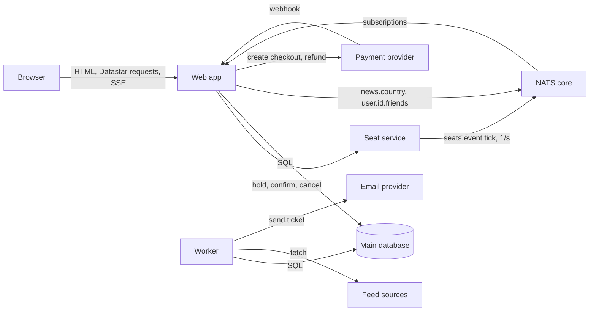
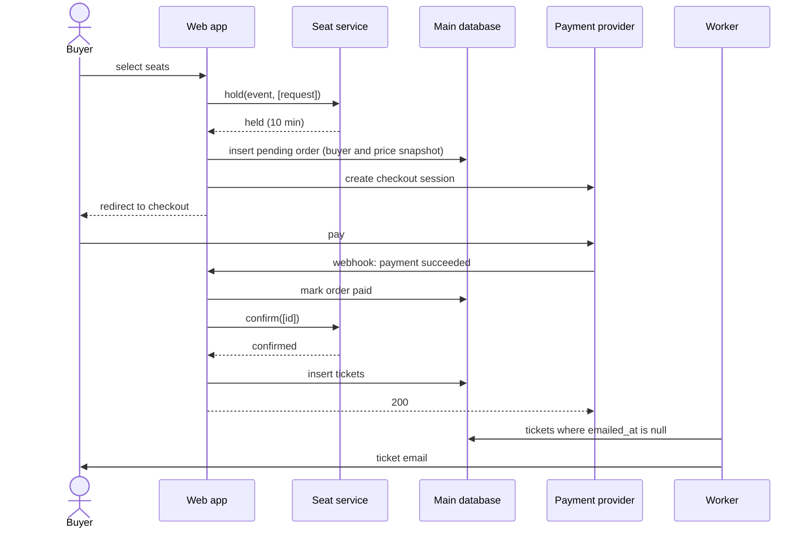

# ADR-001: OneSport architecture

| | |
|---|---|
| Status | Accepted |
| Date | 2026-10-29 |
| Scope | The whole OneSport system: news, events and ticket sales, social features, accounts, back office |
| Supersedes | none |

## 1. Context

OneSport is a sports news site where users can also buy tickets. The requirements are a short system description and 24 user stories, all written for the role User. Most stories are commodity work: signup, login, logout, profile settings and credential changes (1, 2, 3, 4, 6), and list views (7, 11, 20, 21, 22). They shape no architectural choice and this record does not discuss them further.

Seven drivers shape the design. Two of them come from the system description rather than from a story: no story buys a ticket, but the description promises "a convenient platform for purchasing tickets", and no story writes news, but "up-to-date" coverage of many sports needs both feeds and editors.

| # | Driver | Source | Why it matters |
|---|---|---|---|
| D1 | Native ticket sale | System description; stories 11–14 | Many buyers compete for the last seats of one event. Payment goes through an external provider. Orders must outlive the user. |
| D2 | Two ways to sell an event: inside OneSport or by link to the organiser's vendor | Scope decision | The variation must not create two checkout code paths. |
| D3 | News and events come from feeds and from editors, and carry a country | System description; stories 7, 8, 11, 12 | Background ingestion from external systems, one model for two origins, per-source review policy. |
| D4 | A back office for Editor and Admin | Inferred from D3 | Roles that no story names: writing, review queue, source configuration, event and seat layout entry. |
| D5 | Saved items reference content with its own lifecycle | Stories 9, 10, 13, 14, 15, 20, 21 | Articles are withdrawn, events end, sell out or are cancelled, while users still hold references. |
| D6 | Friend requests, and lookup by email | Stories 16–19, 22–24 | A request state machine, a symmetric relation, and a lookup that can reveal who has an account. |
| D7 | Account deletion | Story 5 | Removes social and saved data but must keep orders. |

The design rests on these assumptions:

- A1. Some events sell inside OneSport and others link to an outside vendor.
- A2. News and events arrive from outside feeds and from in-house editors.
- A3. The roles are User, Editor and Admin. Event organisers do not log in.
- A4. OneSport does not process card data. A payment provider does.
- A5. Popular events sell out in minutes, so many buyers compete for the last seats at once.
- A6. Payment providers retry a webhook until the receiver accepts it.
- A7. News sites depend on search engine traffic, so news pages must be indexable.

The discussion settled on these design rules:

1. One single-threaded writer per event owns that event's seats. One event never spans two writers.
2. The Seat service does not face the internet and holds no money and no user data.
3. Every Seat service call takes a batch and carries an idempotency key. A single click is a batch of one.
4. Nothing writes on a timer. Expiry is a condition on status and creation time.
5. Every value on a page has one source. A value that is pushed is never also pulled.
6. Push is built once for the whole system. Publishers other than the Seat service publish only after their transaction commits.
7. Variation lives in data. `fulfilment_mode` and a source's `policy` are each read in exactly one place.
8. Content is never hard-deleted. Articles are withdrawn; events stay after they end.
9. The first editor edit locks an ingested item against later feed updates.
10. No cache that needs invalidation.
11. The website has no JSON API.
12. Orders store a snapshot of the buyer and the prices at purchase time.

## 2. Architectures considered

| | Content (D3, D4) | Purchasing (D1, D2) | Social and accounts (D5, D6, D7) | Verdict |
|---|---|---|---|---|
| A. Modular monolith with one database and a worker mode | Feed adapters run in the worker mode; the back office is part of the same app. | Seat rows sit in the shared database; buyers queue on row locks for a hot event. | Foreign keys; deletion is one transaction. | Chosen, with purchasing carved out into the Seat service. |
| B. Domain services with their own databases and a message broker | A content service owns ingestion and the back office. | A commerce service separates sale load from news, but the hot row stays inside it. | Deletion becomes a cascade of messages; saved items reference another service's data. | Rejected: it pays for a broker and distributed deletion to isolate one part, which A can carve out alone. |
| C. Event log with read models | Ingestion and edits become events; projections serve the views. | Reservations become events, and the last seat still needs one sequencer per event. | An append-only log conflicts with deletion. | Rejected: its one gain, edit history, comes from a revisions table. |
| D. Composition of managed services | A headless CMS supplies the editor UI. | The provider takes payment, but no managed service holds seat inventory. | Users and friendships spread across vendors. | Rejected: the hardest part, seat inventory, is not a commodity. |

Purchasing decided the choice. Every shape that survived needs one writer per event to handle the last seats, so the architectures differ only in where that writer lives. B and C bring no advantage for purchasing over A with the writer carved out, and they make deletion, saved items and the country filter harder, because those join content with users.

## 3. Decision

OneSport is a modular monolith on one main database, plus one separate component: a Seat service that owns seat inventory with one single-threaded writer per event. A worker mode of the same codebase pulls feeds and sends ticket emails. Live values reach pages by push over NATS core and server-sent events, and pages are server-rendered HTML with Datastar.

### 3.1 Components

| Component | Instances | Owns | Does |
|---|---|---|---|
| Web app | Several, behind a load balancer | Nothing between requests except open SSE streams | Renders pages and the back office, handles Datastar requests and payment webhooks, calls the Seat service, forwards bus messages to open pages. |
| Worker | One or more | Nothing | Runs feed adapters on each source's interval; sends ticket emails. Same codebase as the Web app. |
| Seat service | One at launch; partitioned by event id later | Event seat layouts and reservations | Holds, confirms and cancels seats; publishes each event's availability once per second. |
| Main database | One primary with a replica | Users, roles, friends, content, saved items, prices, orders, tickets, payments | Transactions and foreign keys for everything except seats. |
| NATS core | One cluster | Nothing | Delivers messages to current subscribers and stores none. |
| Payment provider | External | Checkout sessions, card data | Hosted checkout, webhooks with retry, refunds. |
| Feed sources | External | Their own items | Supply news and fixtures. |
| Email provider | External | Nothing of OneSport's | Delivers ticket emails. |

### 3.2 State ownership

| State | Source of truth | Lifetime |
|---|---|---|
| Users, roles, settings | Main database | Until account deletion |
| Friend requests, friendships, lookup counters | Main database | Until resolved, removed, or account deletion |
| Sources, articles, revisions, event details, prices | Main database | Permanent; withdrawn, never deleted |
| Saved articles and events | Main database | Until removed or account deletion |
| Orders with buyer snapshot, tickets, payment records | Main database | Legal retention; outlive the user |
| Event seat layout and reservations | Seat service log | Until the event ends; then the log is archived |
| Seats left per category | Seat service memory, pushed each second | One second |
| Checkout session | Payment provider | Minutes |
| Bus messages | NATS core | Not stored |

Two components store data permanently: the Main database and the Seat service log. Both write to disk before they answer, so a crash loses no confirmed change. A lost bus message costs at most one second of staleness, because the next tick carries the full state.

### 3.3 Seat service model

**Data.**

- Category: event, name, kind (`named` or `pool`), capacity for pools.
- Seat: category, label. Only named categories have seats.
- Reservation: id, event, idempotency key, order reference from the Web app, lines (category plus seat, or category plus quantity), status, `created_at`.

Statuses are `held`, `confirmed` and `cancelled`. A reservation is *live* when it is `confirmed`, or `held` and less than 10 minutes old. Nobody writes an `expired` status.

**Invariants.**

- R1. A named seat belongs to at most one live reservation.
- R2. For a pool, the quantities of live reservations never exceed capacity.
- R3. Repeating a call with the same idempotency key returns the first result.
- R4. Allowed transitions are `held` → `confirmed` and `held` → `cancelled`. Refunds of confirmed reservations are business policy outside the service.
- R5. Every change is appended to the event's log and flushed to disk before the answer goes out. On start, the service rebuilds memory by replaying the logs of events still on sale.
- R6. The service stores no prices, payments or user data.
- R7. `confirm` on a hold older than 10 minutes succeeds if its seats are still free, and refuses otherwise.

**API.** Every call takes a batch.

| Call | Effect |
|---|---|
| `define_event(event, categories, seats)` | Creates or extends the seat layout. Called by the back office. |
| `hold(event, requests[])` | Creates `held` reservations, or refuses each request whose seats are not free. |
| `confirm(ids[])` | Moves reservations to `confirmed`, under R7. |
| `cancel(ids[])` | Moves `held` reservations to `cancelled`. |
| `availability(event)` | Returns seats left per category. Used by the tick, not by pages. |

### 3.4 Payment confirms the hold directly

1. The Web app forwards the buyer's selection to the Seat service, which holds the seats for 10 minutes.
2. On success, the Web app creates a pending order with the buyer and price snapshot and redirects the buyer to the provider's hosted checkout. The checkout session expires shortly before the hold.
3. If the buyer does not pay, the hold stops being live after 10 minutes and no job cleans it up.
4. If the buyer pays, the provider's webhook reaches the Web app. In the same request the Web app marks the order paid, calls `confirm`, and creates the tickets.
5. If the Seat service is unreachable, the webhook handler returns an error and the provider retries later (A6). `confirm` is idempotent (R3), so a repeated webhook is harmless.
6. If `confirm` refuses because a late payment found its seats taken, the order becomes `paid_unfulfilled`. Whether it is refunded automatically is business policy; the architecture supplies the state and the provider's refund call.

Rejected: an inbox, an outbox table and a worker that relays confirmations to the Seat service. The provider's webhook retry already does that job, so the relay added a moving part with no new guarantee.

### 3.5 Flows

**Purchase.**

**Redirect sale.** For an event with `fulfilment_mode = redirect`, the event page shows the vendor's link. No order, hold or availability exists. The checkout code is the only code that reads `fulfilment_mode`. Saved tickets reference events, so they work for both modes.

**Ingestion.** The Worker runs each source's adapter at the source's interval. The adapter maps an item to an article or event, including its country, and upserts it on (`source_id`, `external_id`), skipping rows with `editor_locked` set. The source's `policy` (`auto_publish` or `review`) sets the initial status. After commit, a published article goes out on `news.<country>`. A new source costs one adapter.

**Back office.** Editors write and edit articles and events, work through the `pending_review` queue, and withdraw items. Every edit appends an article revision, and the first edit of an ingested item sets `editor_locked`. Admins manage sources, their `policy`, and user roles. For a native sale, an editor enters the seat layout, which the Web app passes to the Seat service with `define_event`, and the prices, which stay in the Main database. The back office is part of the Web app, behind the Editor and Admin roles.

**Live updates.** The Seat service publishes each event's full availability on `seats.<event>` once per second. The tick also tells the Web app that the Seat service is alive. The Web app publishes `news.<country>` and `user.<id>.friends` after commit. Each Web app instance subscribes to the subjects its open pages need and patches those pages over SSE.

**Saved items.** `saved_article` and `saved_event` rows reference content by foreign key, one row per user and item. The saved list reads current status from the article or event when it renders, and sold-out state from the push. Story 15 deletes both sets in one transaction. Saving an event holds no seats.

**Friends.** A `friend_request` row exists at most once per pair of users. Acceptance deletes the request and inserts one `friendship` row with the smaller user id first, so the relation is symmetric by construction. A request crossing a pending request in the other direction counts as acceptance.

**Email lookup.** Story 19 accepts an exact email from a logged-in user, counts lookups per user per day in the Main database, answers "not found" for users who turned off `discoverable_by_email`, and shows non-friends only a display name and avatar.

**Account deletion.** One transaction deletes saved items, friend requests in both directions, friendships and lookup counters, sets `order.user_id` and `article.edited_by` to null, and deletes the user. Orders stay complete through their buyer snapshot. Before deletion, the confirmation page lists upcoming tickets; they stay valid. Holds need no action because they stop being live within 10 minutes. After commit, former friends receive `user.<id>.friends`.

### 3.6 Server-rendered HTML with Datastar

Six places on the site hold client state: the seat picker, seats left, the checkout countdown, the friend-request badge, the new-article notice, and the article editor. Everything else is pages and forms.

Pages are server-rendered HTML. Datastar handles requests and pushed updates through one mechanism, server-sent events that patch elements and signals. Signals hold the countdown, the pool quantity picker and the selection on the named-seat map, which the server renders as SVG. The article editor is the one island, a web component that Datastar's morphing leaves alone.

Rejected alternatives, each with its deciding reason:

- htmx: push would need its SSE extension beside the request mechanism, where Datastar uses one mechanism for both.
- Hotwire: no difference from Datastar that matters for OneSport, with more conventions.
- Server-held page state (Phoenix LiveView, Livewire, Blazor Server): memory per open page multiplies during a sell-out.
- Astro: its server is Node, so either the web tier is TypeScript or Astro calls a JSON API.
- A React single-page app: news pages would not be indexable without server rendering (A7).
- Next.js: it fixes the server language as TypeScript, which this record leaves to the builders.

Without a JSON API, a later mobile app gets a thin API over the same service functions, designed for mobile rather than inherited from the website.

### 3.7 NATS core as the bus

The bus carries only values that the next message replaces, so it needs no retention.

- Postgres notifications were the simplest option, but the Seat service would need a connection to the Main database, which undoes its isolation.
- Redis pub/sub would work. NATS core won by a small margin because it does only messaging and cannot drift into a cache.
- Kafka was rejected because it would add a third persistent store for data that is stale after a second.

The cost of not using Postgres notifications is that publishing is not part of the transaction. Rule 6 covers that: publish only after commit.

## 4. Consequences

### What the design gains

- A sell-out loads the Seat service, not the Main database that serves news.
- Deletion, saved items and the country filter work as joins and transactions in one database.
- Two persistent stores, each with a single owner for every piece of state.
- One push mechanism; a new live feature adds a subject.
- Adding a feed source costs one adapter. Adding a sale mode costs one value of `fulfilment_mode` and its checkout branch.

### What the design accepts

- A second persistent store, the Seat service log, with its own backup and archiving.
- Seats left on a page can lag up to one second.
- Corrections from a feed to an item an editor has edited are lost.
- A late payment can find its seats taken, leaving a `paid_unfulfilled` order for refund.
- No JSON API until a mobile app needs one.
- Datastar has a smaller community than htmx or React.

### Failure modes

| Failure | Effect | Loss |
|---|---|---|
| Seat service down | Holds and confirms fail. News, accounts and friends keep working. Webhooks fail and the provider retries. Seats-left numbers stop updating. | None. The log is flushed before each answer; restart replays it in seconds. |
| Main database down | The whole site is down. | None committed, given the replica and backups. |
| NATS core down | Live values freeze. The missing tick marks seats-left as stale on open pages. | None. |
| One Web app instance down | Its open SSE streams reconnect to another instance. In-flight requests fail; retries are safe through idempotency keys. | None. |
| Worker down | Feeds pause and ticket emails wait. | None. Emails go out when the Worker returns, by `emailed_at` being null. |
| Payment provider down | No new checkouts. Existing holds lapse after 10 minutes. | None. |
| A feed source down | That source's items stop. Other sources continue. | None. |

## 5. Open decisions

| # | Decision | Options | Recommendation | Deciding factor |
|---|---|---|---|---|
| O1 | Server language | Any language with a server-rendered HTML ecosystem and a Datastar SDK or SSE support | Left to the implementers by decision | Familiarity outweighs the rest. Compare static type checking, how easily model-written code can be reviewed, cost of many idle SSE connections, and HTML templating. |
| O2 | Main database product | PostgreSQL, MySQL | PostgreSQL | Foreign keys with `ON DELETE SET NULL`, transactional deletes, wide hosting. No requirement points elsewhere. |
| O3 | Payment provider | Any provider with hosted checkout | One with retried webhooks, a refund API and a settable session expiry | Session expiry shorter than the hold keeps late payments rare. |
| O4 | Seat log format | One append-only file per event; an embedded database | One append-only file per event, flushed per batch | Replay reads one file and needs no second database engine. |
| O5 | Seat service distribution | One node; partition by event id | One node at launch | No known sale needs more, and one event never spans nodes. |
| O6 | Named-seat map | Signal-driven SVG; a second island | Signal-driven SVG | A prototype decides. |
| O7 | Publish availability on commit as well as on the tick | Tick only; both | Tick only | Measure a hot sale first. |

## 6. Glossary

- **Web app**: the modular monolith that serves pages, the back office and webhooks.
- **Worker**: the Web app's codebase in worker mode; runs feed adapters and sends ticket emails.
- **Seat service**: the separate component that owns seat layouts and reservations, one single-threaded writer per event.
- **Main database**: the relational database that owns all state except seats.
- **NATS core**: the message bus, without persistence.
- **Payment provider**, **Feed sources**, **Email provider**: external services.
- **Hold**: a `held` reservation, live for 10 minutes.
- **Live reservation**: one that is `confirmed`, or `held` and less than 10 minutes old.
- **Tick**: the Seat service's once-per-second publish of an event's full availability.
- **Fulfilment mode**: an event field, `native` or `redirect`, read only by checkout.
- **Source policy**: a feed source field, `auto_publish` or `review`, read only by ingestion.
- **Editor lock**: the `editor_locked` flag set by an editor's first edit; feed upserts skip locked rows.
- **Island**: a self-contained web component on a server-rendered page; OneSport has one, the article editor.
- **Datastar**: the hypermedia library that patches page elements and signals over server-sent events.
- **Signal**: a client-side value in Datastar, bound to elements on the page.
